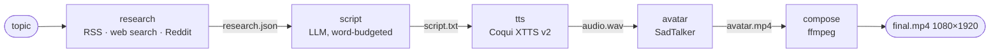

# ai-avatar-agent

[](https://github.com/adityam789/ai-avatar-agent/actions/workflows/ci.yml)


Give it a topic; get a vertical short-form video: **research → LLM script → text-to-speech → talking-head avatar → ffmpeg composite**
(avatar stacked over a looping background clip, 1080×1920).


*What you are seeing:* the output of the **offline demo mode** (`make demo`) — a placeholder avatar and background, a silent
"fake" voice and a canned script, because the offline mode swaps every external service for a deterministic fake. It proves the pipeline, the
compositing and the run-directory layout end to end on a laptop without a GPU, network or API keys. A real run uses a talking-head model (SadTalker),
a neural voice (Coqui XTTS v2) and an LLM. Full-quality MP4: [docs/assets/demo.mp4](docs/assets/demo.mp4).

## Project status

**Feature-complete prototype, now archived / maintenance-only.** Two upstream integrations are affected by API changes (details in
[docs/KNOWN_ISSUES.md](docs/KNOWN_ISSUES.md)): the Google Custom Search JSON API is closed to new customers and discontinued on 2027-01-01 (kept as a
deprecated provider; DuckDuckGo is the default), and the Reddit Data API now requires approval (the Reddit collector is optional). OpenRouter's free models rotate and
throttle without notice. **Offline demo mode works with no keys.**

What has and has not been verified: the test suite (400+ tests, 97 % branch coverage, no GPU/network needed) and the offline pipeline with real ffmpeg are
exercised by the test suite (the CI workflow is included; it has not been run on GitHub yet). The real XTTS and SadTalker stages, live web search and live LLM calls are covered by mocked tests only — they were last run on an
Apple-Silicon Mac before this cleanup and have not been re-run end to end since.

## How it works



* **Research** — three optional sources (RSS feeds, a web-search provider, Reddit) run in parallel threads with a hard timeout each; a dead source is logged and skipped.
  Snippets are de-duplicated, truncated to a budget and distilled into 1–8 facts by the LLM (strict JSON with salvage for chatty replies). Results are cached on disk for 24 h.
* **Script** — the LLM writes a ~18 s narration from the facts (prompt template in `src/ai_avatar/prompts/script.md`). The result is word-counted (±25 % of 2.5 words/s, one corrective retry, then trimmed at a sentence boundary) and sanitised for speech (no markdown, emoji or stage directions).
* **TTS** — Coqui XTTS v2 (lazy-loaded; device `auto` = CUDA > MPS > CPU, MPS runs on CPU because XTTS is unreliable there). Optional voice cloning from a reference clip. Output is verified (exists, duration > 0).
* **Avatar** — SadTalker (git submodule) animates one still image with the audio. A thin wrapper isolates its CWD/`sys.argv` assumptions, passes absolute paths and detects the output explicitly.
* **Compose** — a pure, unit-tested `build_ffmpeg_cmd` builds the filter graph: both tiles are scaled-and-cropped (never stretched) to 1080×1920 total, encoded H.264/AAC `yuv420p`, `+faststart`, duration = audio length.

Each stage writes one file into `outputs/<timestamp>-<topic>/`, so runs are inspectable and **resumable**. See [docs/architecture.md](docs/architecture.md).

## Quickstart

Prerequisites: Python 3.10 (3.11 also works for everything except the real SadTalker stack), `ffmpeg`/`ffprobe`, git.

```bash
git clone --recurse-submodules https://github.com/adityam789/ai-avatar-agent.git
cd ai-avatar-agent
python3.10 -m venv .venv && source .venv/bin/activate
pip install -e ".[dev]"      # light install: no torch, no TTS

ai-avatar doctor             # shows what is installed / missing (names of env vars only, never values)
make demo                    # = ai-avatar run "OpenAI" --offline  -> outputs/<timestamp>-openai/final.mp4
pytest                       # ~10 s, no GPU/network
```

(`--recurse-submodules` is only needed for real avatar runs; the offline demo uses the bundled placeholder avatar.)

### A real run

`coqui-tts` and SadTalker's pinned stack cannot be installed into the same environment (numpy/scipy/librosa/torch pins clash, see
[KNOWN_ISSUES](docs/KNOWN_ISSUES.md)), so use **two virtualenvs** and let the resumable run directory hand work over:

```bash
cp .env.example .env         # add OPEN_ROUTER_API_KEY (names are documented in .env.example); optional: Reddit / Google keys

# env A: research + script + speech
python3.10 -m venv .venv-tts && .venv-tts/bin/pip install -e ".[tts,search]"
.venv-tts/bin/ai-avatar run "Octopus intelligence"     # ends at the avatar stage with an expected error (this env has no SadTalker)

# env B: talking head + composite (download SadTalker weights once: models/sad_talker/scripts/download_models.sh)
python3.10 -m venv .venv-avatar && .venv-avatar/bin/pip install -e ".[avatar]"
.venv-avatar/bin/ai-avatar run "Octopus intelligence" --resume outputs/<the-run-directory>
```

Use your own face image and loop: `--avatar-image me.png --loop clip.mp4` (see *Licensing & responsible use*). Useful flags:

| Flag | What it does |
|---|---|
| `--dry-run` | validate setup, print the plan and which checks fail, run nothing |
| `--offline` | fixtures + fake LLM/TTS/avatar; no network, keys or GPU |
| `--resume DIR` / `--from-stage S` / `--only-stage S` | continue or re-run part of a run |
| `--script-file F` / `--audio WAV` | supply your own script or audio, skipping those stages |
| `--no-background` | output the avatar video alone |
| `ai-avatar research TOPIC` / `script TOPIC` | run just the first stages and print the result |

`ai-avatar --help` lists everything. Exit codes: 0 ok, 1 expected failure (message on stderr, traceback only with `-v`), 2 usage, 70 unexpected, 130 Ctrl-C.

### Configuration

Defaults live in [`config/default.yaml`](config/default.yaml); override with `--config my.yaml` or env vars such as `AI_AVATAR__tts__device=cpu`.
Secrets only ever come from the environment / `.env` (see [`.env.example`](.env.example)).

| Key | Default | Meaning |
|---|---|---|
| `offline` | `false` | use fixtures and fakes (also `--offline`) |
| `video.width` / `height` | 1080 / 1920 | output size; `crf` 20, `preset` veryfast |
| `avatar.image` | `assets/avatars/placeholder.png` | still image to animate (use a face you have rights to) |
| `avatar.height_ratio` | 0.55 | share of the frame used by the avatar tile |
| `avatar.size` / `enhancer` | 256 / none | SadTalker render size (256/512) and optional GFPGAN |
| `background.enabled` / `loop` | true / `assets/loops/placeholder_loop.mp4` | looping clip under the avatar |
| `tts.voice` / `language` / `device` | Ana Florence / en / auto | XTTS speaker, language, device |
| `tts.speaker_wav` | null | reference clip for voice cloning |
| `llm.base_url` / `models` | OpenRouter / one `:free` model | any OpenAI-compatible endpoint; models tried in order |
| `llm.max_retries` | 3 | retries after the first attempt (429/5xx/timeouts, exponential backoff) |
| `script.target_seconds` / `tone` | 18 / factual, concise, engaging | narration length and style |
| `research.collectors` | `[rss, web_search, reddit]` | enabled sources |
| `research.search_provider` | `duckduckgo` | `duckduckgo` (no key), `google_cse` (deprecated), `static` |
| `research.cache_ttl_hours` | 24 | disk cache lifetime (`.cache/research`) |
| `paths.outputs_dir` | `outputs` | where run directories go |

## Project layout

```
config/default.yaml        all defaults            fixtures/research/   canned snippets for offline mode
src/ai_avatar/
  cli.py  __main__.py      argparse CLI            pipeline.py          planner + resumable runner
  config.py                pydantic config         checks.py            doctor / dry-run checks
  research/                collectors/, aggregator, cache, agent
  llm/                     client (retries, fallback), fake, json_utils
  stages/                  script, tts, avatar, compose, fakes
  redact.py  errors.py  logging_setup.py
tests/                     pytest, 400+ tests, network guard in conftest.py
docs/                      architecture.md, KNOWN_ISSUES.md, RESUME_BULLETS.md, tasks/ (the cleanup work log)
models/sad_talker/         git submodule (fork of OpenTalker/SadTalker) — untouched
assets/                    generated placeholder avatar + background loop
```

## Design decisions and trade-offs

* **Staged pipeline with file artifacts** instead of in-memory objects: inspectable, resumable, and each stage can run in a different environment (which is what the TTS/SadTalker dependency clash requires).
* **One planner for real runs and `--dry-run`**, validated up front, so the dry run cannot disagree with a real run and an impossible request changes nothing on disk.
* **Fail-soft collectors with wall-clock timeouts**; only "no research at all" is an error. Upstream APIs die (two already did), the project should not.
* **Pluggable providers** behind small protocols (`SourceCollector`, `SearchProvider`, `build_llm`) — Google CSE → DuckDuckGo was a config change.
* **Fakes for every heavy dependency** (LLM, TTS, avatar, search fixtures) so CI exercises the real pipeline code and real ffmpeg with no GPU, network or secrets.
* **Lazy imports** — `--help`, `doctor`, tests and the offline demo never import torch or TTS.
* **Secrets hygiene** — `.env` only; `redact.scrub()` on everything derived from exceptions, a logging filter for third-party loggers, `run.json` never contains env values.
* **The submodule is never edited**: the wrapper works around SadTalker's CWD/`sys.argv` assumptions instead of forking behaviour.

## Limitations and roadmap

* Real-hardware paths are mock-tested only (see *Project status*); SadTalker has no MPS support and no output path return value.
* Free OpenRouter models are unreliable — configure several or point `llm.base_url` at another provider.
* Captions (burned-in subtitles) are not implemented; the pipeline would need to pass the script to the compose stage.
* Next upgrades if revived: a newer talking-head model (the SadTalker pins force an old torch), streaming TTS, captions with word timing, Brave/other search providers, a small FastAPI service.

## Licensing and responsible use

* **This project's code:** no licence has been chosen yet (an MIT licence is proposed — see `docs/tasks/OWNER_QUESTIONS.md`); until a `LICENSE` file is added, all rights are reserved by the author.
* **SadTalker** (git submodule): code is Apache-2.0; its pretrained weights and bundled third-party components (e.g. BFM, face-alignment models, GFPGAN) carry their own terms — read them before redistributing or commercial use.
* **Coqui XTTS v2** weights: Coqui Public Model License — **non-commercial** use only.
* **OpenRouter models** have their own terms; check each model's licence and data policy.
* **Synthetic-media disclosure:** videos from this tool are AI-generated (synthetic voice and face). Label them as such where platforms or law require it.
* **Responsible use:** only animate faces and clone voices you have the rights and consent to use. Do not impersonate real people or produce deceptive content.
* The bundled `assets/avatars/placeholder.png` and `assets/loops/placeholder_loop.mp4` are generated with ffmpeg for this repo and carry no third-party content.
