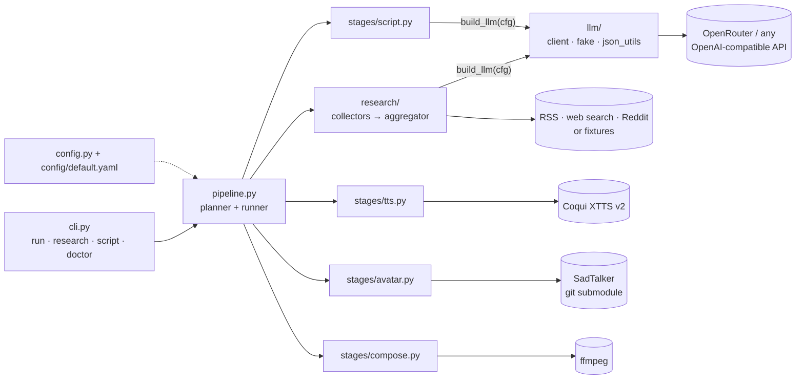

# Architecture

`ai-avatar-agent` turns a topic into a vertical (1080x1920) talking-head video. It is a small **staged pipeline**: every stage reads
files from a run directory and writes exactly one artifact, so any run can be inspected, resumed, partly re-run or fed pre-made inputs.

## Components



## Data flow and run directory


```
outputs/<YYYYmmdd-HHMMSS>-<topic-slug>/
    research.json   facts + source links (URL, title) used for the script
    script.txt      narration text (TTS-sanitised, word-budgeted)
    audio.wav       synthesized speech
    avatar.mp4      talking-head video (SadTalker output copied here)
    final.mp4       avatar stacked over the looping background, 1080x1920
    run.json        topic, per-stage status/timings, model names, versions, config hash (never secrets)
    sadtalker/      SadTalker's own scratch/output directory
```

### Resume and selective re-runs
`pipeline.planned_stages()` is the single planner used by both a real run and `--dry-run`:

* a stage is skipped when its artifact — or any *later* stage's artifact — already exists;
* `--from-stage S` forces `S` and everything after it; `--only-stage S` re-runs just `S`;
* `--script-file` / `--audio` copy your file in as `script.txt` / `audio.wav`, which makes earlier stages unnecessary and discards later artifacts;
* re-running a stage (via `--from-stage`, an override or a plain resume) deletes its old output and everything derived from it first (`--only-stage` leaves later artifacts in place and logs that they are now stale), and a failed or interrupted stage removes its partial
  artifact, so `--resume` never trusts a half-written file;
* an impossible plan (missing input, wrong topic, corrupt `run.json`, override that a forced stage would overwrite) fails **before** anything is touched.

## Error-handling model
* Expected failures are typed (`errors.py`: `ResearchError`, `LLMError`, `TTSError`, `AvatarError`, `ComposeError`, `PipelineError`, `ConfigError`).
  The CLI prints `error: <message>` and exits 1; tracebacks only with `-v`.
* Unexpected exceptions inside a stage are wrapped in that stage's error type with an actionable message (e.g. a missing optional dependency
  becomes `pip install -e '.[tts]'`).
* **Fail-soft research:** every collector runs in a daemon thread with a wall-clock timeout; a failing/slow/absent source is logged and
  skipped. Only "no snippets from any source" is an error.
* **Secrets:** anything derived from an exception passes through `redact.scrub()` (env secret values and `?key=…` URL parameters) before it reaches
  logs, `run.json` or the terminal; a logging filter does the same for third-party loggers such as urllib3.

## Offline mode
`--offline` (or `offline: true`) swaps the external pieces for deterministic fakes so the whole pipeline runs with no network, keys or GPU:
fixture research snippets, `FakeLLM`, `FakeTTS` (silent wav whose length follows the word count), `FakeAvatar` (the still image + audio rendered by
ffmpeg). ffmpeg itself is always real. This is what the tests and the README demo use.

## Extension points
* **New collector:** subclass `SourceCollector` (`research/collectors/base.py`), implement `collect(topic) -> list[RawSnippet]`, then add its name to
  `KNOWN_COLLECTORS` and `build_collectors` in `research/collectors/__init__.py` and to the `ResearchConfig.collectors` `Literal` in `config.py`; offline mode also needs `fixtures/research/<name>.json`. Failures are isolated by `safe_collect`; you do not
  need to catch exceptions.
* **New search provider:** implement `SearchProvider.search(query, n) -> list[SearchResult]` (with a `name` attribute) in `research/collectors/search_providers.py`, return it
  from `_search_provider` in `research/collectors/__init__.py` and add its name to the `ResearchConfig.search_provider` `Literal`.
* **New stage:** add a `Stage(name, artifact, fn, error, requires=…)` to `pipeline.DEFAULT_STAGES`; `fn(ctx)` reads `ctx.path(...)` files and writes its
  artifact. Planning, resume, invalidation and error wrapping come for free.
* **Different LLM:** point `llm.base_url` at any OpenAI-compatible chat-completions endpoint and list `llm.models`. For OpenRouter the list is sent as a
  server-side fallback array; for other hosts the client tries the models in order.
* **Different talking-head model:** replace `stages/avatar.py` (`generate_avatar(audio, image, result_dir, cfg) -> Path`).

## Dependency layout
Core install is light (`requests`, `pyyaml`, `python-dotenv`, `feedparser`, `pydantic`). Heavy pieces are optional extras and are imported lazily, so
`ai-avatar --help`, `doctor`, the tests and the offline demo need no torch: `[tts]` (coqui-tts), `[avatar]` (SadTalker's pinned stack), `[search]`
(ddgs), `[reddit]` (praw), `[dev]`, `[api]` (FastAPI wrapper in `api.py`, see the README). `[tts]` and `[avatar]` cannot share one environment — see [KNOWN_ISSUES.md](KNOWN_ISSUES.md).
